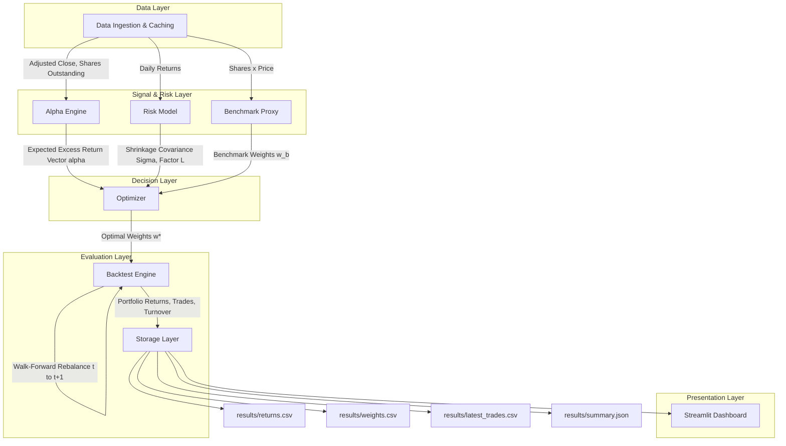

# IndexPulse: Enhanced Indexing on Nifty 50

[](.github/workflows/ci.yml)
[](pyproject.toml)
[](pyproject.toml)
[](LICENSE)

---

## ⚠️ Disclaimer

**This repository is strictly for research and academic purposes.** It demonstrates systematic portfolio construction, convex optimization, and quantitative risk modeling techniques applied to a public equity index. **Nothing here constitutes investment advice, a recommendation, or a solicitation to buy or sell any security.** Backtested performance is hypothetical, does not reflect actual trading, and is not indicative of future results. Consult a licensed financial advisor before making investment decisions.

---

## Quick Start (3 commands)

```bash
# 1. Install
pip install -r requirements.txt && pip install -e .

# 2. Run the full pipeline (data → signals → risk → optimize → backtest → results/)
python -m eindex.pipeline

# 3. Launch the dashboard
streamlit run app/streamlit_app.py
```

> **Docker alternative** — see the [Deploy](#deploy) section.

---

## Screenshots

| Overview | Active Positions |
|---|---|
| _(run the pipeline and open the dashboard to generate)_ | _(run the pipeline and open the dashboard to generate)_ |

---

## 1. Project Overview

**IndexPulse** is a systematic quantitative strategy applied to the **Nifty 50** universe. It constructs a portfolio that:

- Seeks **positive alpha** relative to a market-cap-weighted benchmark proxy using three transparent, price-only signals.
- Maintains **tight active risk** via explicit constraints on annualized tracking error, single-stock active weight, and sector active weight.
- Controls **transaction costs and turnover** through an explicit cost penalty and a hard turnover cap, with a graduated constraint-relaxation fallback ladder.
- Is implemented end-to-end as a **convex QP** (CVXPY + CLARABEL), so every weight is the certified solution — or a documented relaxation — of a well-posed problem.

Strict **point-in-time discipline**: signals computed at the close of day *t* are executed only at the close of day *t+1*.

---

## 2. Architecture



### 2.1 Data (`src/eindex/data.py`)

- Downloads **adjusted close prices** and **shares outstanding** via `yfinance` (`.NS` tickers).
- **Parquet-cached** with a 1-day TTL; falls back to `data/static_sectors.csv` on API failure.
- Cleans: drops tickers with >5% missing data, forward-fills gaps ≤3 days, raises on remaining NaNs.

### 2.2 Alpha Engine (`src/eindex/signals.py`)

| Factor | Definition | Rationale |
|---|---|---|
| **12-1 Momentum** | 12-month return, skipping last month | Intermediate trend; avoids reversal contamination |
| **60-day Low Volatility** | Negative of trailing 60-day realized vol | Low-vol anomaly |
| **1-Month Reversal** | Negative of trailing 1-month return | Short-term mean reversion |

Per-rebalance processing: **winsorize** (1st/99th pct) → **cross-sectional z-score** → **combine** (weights 0.40/0.30/0.30) → **re-z-score** → scale to alpha via IC mapping:

$$\alpha_i = IC \times \sigma^{\text{annual}}_i \times z_i \quad (IC = 0.05)$$

### 2.3 Risk Model (`src/eindex/risk.py`)

- **Ledoit-Wolf shrinkage covariance** on daily returns, annualized ×252.
- **Symmetrized** and **eigenvalue-floored** at ≥1e-8 to guarantee PSD.
- **Factor decomposition** `Σ = L Lᵀ` for DCP-compliant quadratic form in CVXPY.

### 2.4 Optimizer (`src/eindex/optimizer.py`)

**Maximize:**
$$\alpha^T a - \lambda \|L^T a\|_2^2 - \frac{\text{cost\_bps}}{10000} \|w - w_{\text{prev}}\|_1$$

where $a = w - w_b$ is the active weight vector.

**Constraints:**

| Constraint | Default |
|---|---|
| Full investment: $\sum w_i = 1$ | — |
| Long-only: $w \ge 0$ | — |
| Single-stock active: $\|w_i - w_{b,i}\| \le$ `max_active_stock` | 2% |
| Sector active: $\|\sum_{i \in S}(w_i - w_{b,i})\| \le$ `max_active_sector` | 3% |
| Tracking error: $\sqrt{a^T \Sigma a} \le$ `max_te_annual` | 3% |
| Turnover (one-way): $0.5\|w - w_{\text{prev}}\|_1 \le$ `max_turnover_oneway` | 20% |

**Fallback ladder** (each step widens constraints and re-solves):
1. Relax turnover ×2
2. Relax sector active ×1.5
3. Return benchmark weights

### 2.5 Backtest (`src/eindex/backtest.py`)

- Month-end walk-forward with ≥504 trading days of history required before first rebalance.
- Weights **drift** between rebalances with daily returns.
- **10 bps** cost deducted on trade day, proportional to one-way turnover.

### 2.6 Analytics & Pipeline (`src/eindex/analytics.py`, `src/eindex/pipeline.py`)

Computes: CAGR, active return, tracking error, IR, Sharpe, beta, max drawdown, hit rate.
Writes: `results/returns.csv`, `results/weights.csv`, `results/latest_trades.csv`, `results/summary.json`.
CLI: `python -m eindex.pipeline [config.yaml]`

---

## 3. Configuration (`config.yaml`)

| Key | Default | Description |
|---|---|---|
| `start_date` | `"2015-01-01"` | Historical data start |
| `rebalance_freq` | `"ME"` | Rebalance frequency (pandas offset alias) |
| `lookback_cov_days` | `504` | Rolling window for covariance estimation |
| `signal_weights.momentum` | `0.4` | Momentum signal weight |
| `signal_weights.low_vol` | `0.3` | Low-volatility signal weight |
| `signal_weights.reversal` | `0.3` | Reversal signal weight |
| `ic` | `0.05` | Information coefficient (alpha scaling) |
| `risk_aversion` | `10.0` | Risk aversion parameter λ |
| `max_active_stock` | `0.02` | Max per-stock active weight |
| `max_active_sector` | `0.03` | Max per-sector active weight |
| `max_te_annual` | `0.03` | Annualized tracking-error ceiling |
| `max_turnover_oneway` | `0.20` | One-way turnover cap per rebalance |
| `cost_bps` | `10.0` | Transaction cost in basis points |
| `tickers` | _(50 Nifty tickers)_ | Universe (`.NS` NSE tickers) |

---

## 4. Repository Structure

```text
IndexPulse/
├── src/eindex/
│   ├── config.py          # Config loading & Pydantic validation
│   ├── data.py            # yfinance ingestion, Parquet caching
│   ├── signals.py         # Alpha factor computation
│   ├── risk.py            # Ledoit-Wolf covariance, PSD factor
│   ├── optimizer.py       # CVXPY problem, fallback ladder
│   ├── backtest.py        # Walk-forward engine
│   ├── analytics.py       # Performance metrics
│   └── pipeline.py        # Orchestration + CLI
├── tests/                 # 37 tests (look-ahead, PSD, constraints, AppTest)
├── app/streamlit_app.py   # Interactive dashboard (8 tabs)
├── .github/workflows/
│   ├── ci.yml             # Ruff + mypy + pytest on push/PR
│   └── rebalance.yml      # Monthly cron rebalance → commit results/
├── Dockerfile             # Non-root, healthcheck, port 8501
├── .dockerignore
├── Makefile               # install / test / lint / run-pipeline / run-app
├── config.yaml            # Strategy parameters
├── pyproject.toml
└── requirements.txt
```

---

## 5. Assumptions & Limitations

| Limitation | Detail |
|---|---|
| **Survivorship bias** | Universe uses *current* Nifty 50 constituents — historical dropouts are excluded, biasing returns upward. |
| **Proxy benchmark** | Market-cap weights reconstructed from current shares outstanding × historical prices, not the official free-float methodology. |
| **Price-only signals** | No fundamental, earnings, or alternative data. Point-in-time fundamental datasets are not freely available without silent look-ahead risk. |
| **No market impact** | Slippage and market-impact cost are not modelled. The 10 bps flat cost is a simplified proxy. |
| **Backtest ≠ live** | Simulated walk-forward is not a live track record. Past hypothetical performance does not predict future results. |

---

## 6. Testing

```bash
make test   # pytest with coverage (≥70% required)
make lint   # ruff check + ruff format check + mypy
```

Key correctness guarantees enforced by the test suite:

- **Look-ahead bias** — truncating prices after date *t* produces identical weights at *t*.
- **PSD floor** — all eigenvalues of the output covariance ≥1e-8.
- **Constraint satisfaction** — `sum(w)==1`, `w≥0`, active weight, TE, and turnover all verified post-solve.
- **Fallback ladder** — infeasible inputs escalate correctly to benchmark fallback.
- **AppTest** — dashboard runs without exceptions in demo mode, with real fixtures, and with partial results.

---

## 7. Deploy

### Local (Makefile)

```bash
make install       # pip install all deps
make run-pipeline  # generate results/
make run-app       # launch dashboard at http://localhost:8501
```

### Docker

```bash
# Build
docker build -t indexpulse .

# Run (mounts a local results/ directory so pipeline outputs persist)
docker run -p 8501:8501 -v "$(pwd)/results:/app/results" indexpulse
```

The container runs as a non-root user (`appuser:appgroup`, uid 1001) and exposes a healthcheck at `/_stcore/health`.

### GitHub Actions — Monthly Rebalance

`.github/workflows/rebalance.yml` runs on the 2nd of every month (06:00 UTC) and on `workflow_dispatch`. It:
1. Runs `python -m eindex.pipeline`
2. Commits any changed files under `results/` back to `main` using the `github-actions[bot]` identity.

> The workflow requires `permissions: contents: write` (already set in the file). No additional secrets are needed beyond the default `GITHUB_TOKEN`.

---

## License

Distributed under the [MIT License](LICENSE).
